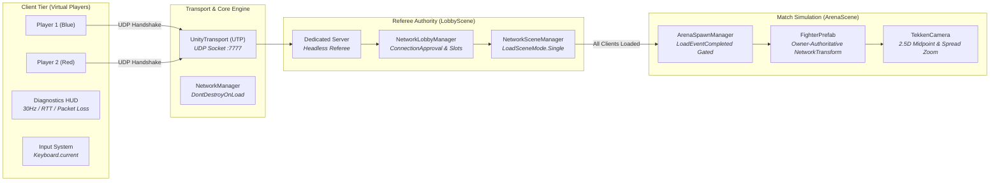
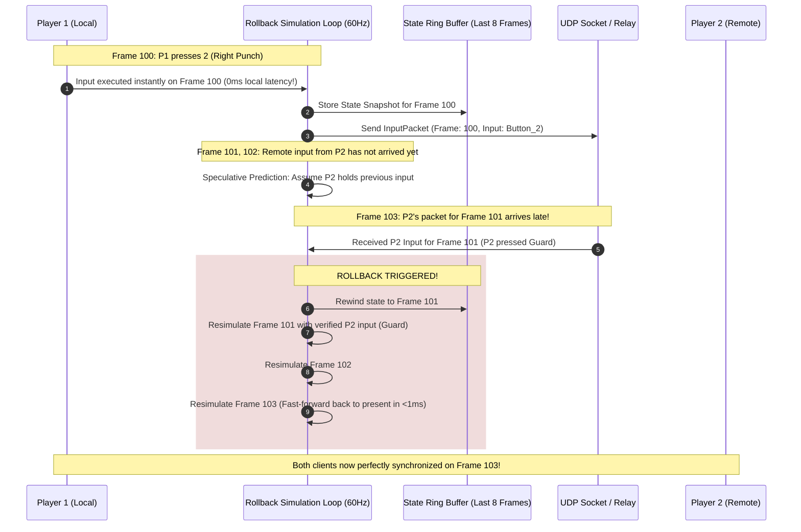
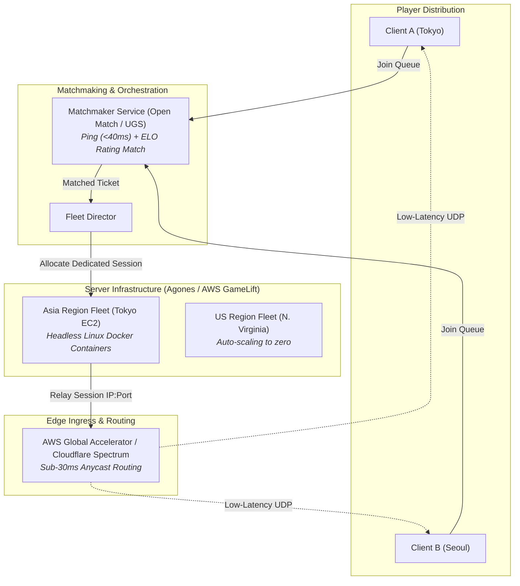

# Scaling Strategy: From Netcode Prototype to AAA Tekken-Level Multiplayer

> **Target Audience:** Technical Game Interviewers, Lead Multiplayer Engineers, Technical Directors.  
> **Repository:** [ShishuPanda/NetCode](https://github.com/ShishuPanda/NetCode)  
> **Interactive Diagrams:** [project-architecture.html](file:///j:/UnityProjects/NetCode%20Unity%20Project/NetCode%20Unity/Assets/project-architecture.html) | [project-sequence.html](file:///j:/UnityProjects/NetCode%20Unity%20Project/NetCode%20Unity/Assets/project-sequence.html)

---

## 1. Executive Summary & 30-Second Interview Elevator Pitch

> *"This project is an architectural foundation benchmarking Netcode for GameObjects (NGO) under 2.5D fighting game constraints. We solved topology flexibility (Listen Host vs. Headless Dedicated Server), authoritative connection approval, synchronized multi-client scene transitions, and owner-authoritative transform replication without physics jitter.*  
>  
> *To scale this to a commercial, tournament-grade fighting game on par with Tekken 8 or Street Fighter 6, our roadmap transitions the combat layer from client-server snapshot interpolation to a **Deterministic Rollback Netcode (GGPO-style) state machine**, while keeping the current lobby, relay, matchmaking, and telemetry layers intact at the cloud boundary. Here is exactly how that pipeline scales."*

---

## 2. Baseline Architecture: What This Prototype Proves

Before discussing scaling, establish credibility by showing what the current prototype accomplishes cleanly:



### Key Engineering Wins in Current Setup:
1. **Topology Agnostic**: Can run as **Headless Dedicated Server (Referee)** or **Listen Host (Player 1 as host)**.
2. **Deterministic Post-Load Spawning**: Spawning is strictly gated behind `SceneEventType.LoadEventCompleted`. Network entities never instantiate before all clients finish loading `ArenaScene`, avoiding premature desyncs.
3. **Physics Jitter Elimination**: On non-owning clients and on the Dedicated Server, `CharacterController.enabled = false` is enforced on spawn. This stops PhysX from fighting incoming `NetworkTransform` updates.
4. **Resilience to Desync**: `ForceSamePrefabs` disabled and dynamic `AddNetworkPrefab` fallback added, ensuring Multiplayer Play Mode (MPPM) virtual player clones never stall on un-synced asset databases.

---

## 3. The Reality Check: Why Standard Client-Server Netcode Cannot Deliver "Tekken"

An interviewer wants to know if you understand **why fighting games are different from shooters, battle royales, and MMOs**:

| Game Genre (FPS, Battle Royale) | Fighting Games (Tekken, Street Fighter, Smash) |
| :--- | :--- |
| **Tolerance for Latency**: High (50ms–150ms). Hidden by client prediction, hit-scan lag compensation, and transform interpolation buffers. | **Tolerance for Latency**: **Zero (0 to 1 frame / 16.6ms)**. Combos rely on 1-frame links, 10-frame startup jabs, and sub-frame parries. |
| **Simulation Model**: Server-Authoritative continuous floating-point physics. | **Simulation Model**: 60 FPS deterministic frame-lock simulation. Every machine runs the exact same physics and state. |
| **Visual Sync**: Remote player positions are interpolated $50-100\text{ms}$ in the past. | **Visual Sync**: Both players must be rendered on the **same virtual frame**. An interpolation delay would make blocking on reaction impossible. |

> **Interviewer Takeaway**: Standard Netcode for GameObjects (NGO) uses tick-based snapshot interpolation for positions. While excellent for lobbies, movement, and casual brawlers, **competitive fighting games require Deterministic Rollback Netcode (GGPO)**.

---

## 4. The 4-Phase Scale Roadmap

```mermaid
timeline
    title 4-Phase Evolution to Tekken Scale
    section Phase 1 (Complete) : NGO Foundation : Headless Referee / Host : 2.5D Camera & Stage : Live Diagnostics HUD
    section Phase 2 (Arcade Combat) : Combat State Machine : Hitbox / Hurtbox Slices : NetworkVariable Health : Unity Relay Join Codes
    section Phase 3 (Rollback Engine) : Fixed 60Hz Game Loop : Deterministic Fixed-Point : Snapshot Ring Buffer : Rollback & Resimulation
    section Phase 4 (Cloud Infrastructure) : AWS GameLift / Agones : Ping-Based ELO Matchmaking : Replay Serialization : Client-Side Desync Telemetry
```

---

### Phase 1: Prototype Foundation (Current Deliverable)
* **Status**: Complete & Verified.
* **Scope**: Server topologies, connection approval (capped at 4 players), synchronized scene transition, 2.5D camera, owner-authoritative lateral movement, crouch squash, jumping, and telemetry.

---

### Phase 2: Action Combat State Machine (Expanding Current NGO)
Before rewriting the core netcode, scale the current NGO architecture into a fully playable casual fighting game:

#### 1. Transition from Transform Sync to Discrete State Machine
Instead of continuously streaming raw `transform.position` updates, characters are driven by an authoritative discrete state machine:
```csharp
public enum FighterState : byte
{
    Idle,
    WalkingForward,
    WalkingBackward,
    Crouching,
    Startup,       // Attack winding up (cannot block)
    ActiveHit,     // Hitbox enabled
    Recovery,      // Attack finishing (punishable)
    BlockStun,     // Guarded an attack
    HitStun,       // Taking damage
    Knockdown      // On the ground
}
```

#### 2. Frame-Indexed Hitbox & Hurtbox Components
* **Hurtboxes**: Capsule colliders matching body segments (Head, Torso, Legs) listening for hits.
* **Hitboxes**: Trigger colliders attached to limbs (Right Fist, Left Foot) enabled **only** during `FighterState.ActiveHit` frames.
* **Hit Registration**: When a hitbox overlaps an opponent's hurtbox, the attacker invokes `RegisterHitServerRpc(hitData)`. The server validates range, verifies the target is not in invincibility frames, and applies damage:
```csharp
public struct HitData : INetworkSerializable
{
    public byte AttackId;
    public int Damage;
    public float KnockbackForce;
    public byte HitstunFrames;
    public bool IsHighAttack; // High, Mid, Low for blocking logic

    public void NetworkSerialize<T>(BufferSerializer<T> serializer) where T : IReaderWriter
    {
        serializer.SerializeValue(ref AttackId);
        serializer.SerializeValue(ref Damage);
        serializer.SerializeValue(ref KnockbackForce);
        serializer.SerializeValue(ref HitstunFrames);
        serializer.SerializeValue(ref IsHighAttack);
    }
}
```

#### 3. Match Health & Round Timer
* `NetworkVariable<int> P1Health = new NetworkVariable<int>(1000);`
* `NetworkVariable<int> P2Health = new NetworkVariable<int>(1000);`
* `NetworkVariable<float> RoundTime = new NetworkVariable<float>(60.0f);`
* When health reaches 0 or timer expires, the server declares round winner, handles best-of-3 rounds, and triggers `KO` freeze frame.

#### 4. Unity Relay & Lobby Integration
* Remove manual IP/Port typing from `LobbyUI.cs`.
* Integrate `Unity.Services.Relay` and `Unity.Services.Lobbies`:
  * Host creates a match and receives a 6-character **Join Code**.
  * Client inputs the Join Code.
  * Packets traverse NAT/routers via Relay without players needing public IP port-forwarding.

---

### Phase 3: The Competitive Leap — Rollback Netcode Engine (GGPO Model)

To achieve true tournament-grade Tekken gameplay, the match runtime migrates to a **Deterministic Rollback Engine**:



#### Architecture Requirements for Rollback:
1. **Separation of Simulation from Rendering**:
   * Game simulation runs at fixed $60\text{Hz}$ ticks (`Simulate(FrameInputs)`).
   * Visual rendering interpolates at $144\text{Hz}+$ with visual smoothing to avoid character snapping during rollbacks of 1–3 frames.
2. **Fixed-Point Determinism**:
   * Standard IEEE 754 floating-point math produces slight divergences across different CPUs (e.g., x86 vs. ARM / Apple Silicon).
   * Combat positions and physics use fixed-point arithmetic (`FPMath`) so calculations are identical down to the bit.
3. **State Serialization Ring Buffer**:
   * Every frame, a 64-byte to 256-byte snapshot of pure game state is stored in an array of size 64:
     ```csharp
     public struct GameFrameSnapshot
     {
         public uint FrameNumber;
         public FPVector3 P1Position;
         public FPVector3 P2Position;
         public FighterState P1State;
         public FighterState P2State;
         public int P1Health;
         public int P2Health;
         public byte P1CurrentAnimFrame;
         public byte P2CurrentAnimFrame;
     }
     ```
4. **Lightweight Resimulation**:
   * Rewinding 3 frames and re-simulating takes less than $0.5\text{ms}$ on modern CPUs because only math, collisions, and state changes are computed—no audio, particles, or mesh updates occur during rewinds.

---

### Phase 4: Production Cloud Infrastructure & Global Scaling

To support 100,000+ concurrent players across North America, Europe, Asia, and Latin America:



#### 1. Matchmaking Architecture:
* **Latency-First Clustering**: Players are grouped into clusters where mutual ping is $<40\text{ms}$. ELO / skill matching expands outward only if low-ping opponents are unavailable.
* **Rollback-Aware Quality Indicator**: The UI displays estimated rollback frames (e.g., *Ping: 32ms | Jitter: 2ms | Predicted Rollback: 1 frame*), exactly like Tekken 8 and Guilty Gear Strive.

#### 2. Fleet Orchestration:
* Game servers run as headless Linux binaries inside **Docker containers** managed by **Agones** (Kubernetes for game servers) or **AWS GameLift FleetIQ**.
* Dynamic autoscaling scales down server instances during off-peak hours and spins up warm instances within seconds during peak tournament hours.

#### 3. Anti-Cheat & Desync Telemetry:
* **Checksum Verification**: At the end of every frame (or every 60 frames), both clients generate an incremental CRC32 hash of the state snapshot.
* If hashes mismatch, a **Desync Detected** event logs to telemetry, saving the replay input stream for deterministic debugging.
* In tournament matches, the **Headless Dedicated Server acts as the master referee**, running the authoritative simulation while both players connect via Rollback P2P.

---

## 5. Senior Networking Interview Q&A Cheat Sheet

Use these concise, authoritative answers when questioned by interviewers:

### Q1: *"Why did you start with Netcode for GameObjects (NGO) instead of building a rollback engine from scratch?"*
> **Answer:**  
> *"NGO provides a robust, proven pipeline for the macro-lifecycle: authoritative lobbies, connection approval callbacks, multi-topology deployment, and synchronized scene loading via `NetworkSceneManager`. It allowed me to establish the 2.5D stage spatial constraints, dynamic framing camera, and telemetry in a production engine first.  
> The correct commercial approach is to use high-level networking for lobby, matchmaking, and social services, while modularizing the match runtime so the in-game combat simulation can swap to a deterministic rollback loop."*

### Q2: *"How do you handle animations and audio when a 3-frame rollback occurs?"*
> **Answer:**  
> *"You decouple visual/audio triggers from the simulation tick. During the 3-frame resimulation loop, audio calls and particle spawns are muted. Only once the simulation reaches the current present frame do we compare the confirmed state with the speculative state:  
> - If the move wasn't canceled, animation continues seamlessly with visual blending.  
> - If an attack was guarded or hit during rollback, we blend to the correct impact frame over 1–2 visual frames and trigger the impact audio once, preventing audio stutter."*

### Q3: *"How would you eliminate floating-point desyncs across platforms (e.g. PC vs PlayStation vs Mobile)?"*
> **Answer:**  
> *"Unity's PhysX and native `float` operations can differ across SIMD architectures and compiler optimizations. For the rollback simulation, we use integer-based fixed-point math (`FPMath`, 32.32 or 16.16 format) for positions, bounding boxes, and velocity. Rendering uses floats for visual smoothness, but game logic never reads rendering transforms for combat decisions."*

### Q4: *"In our current demo, how did you prevent CharacterController from fighting NetworkTransform?"*
> **Answer:**  
> *"In Unity, if `CharacterController` is enabled on non-owners while `NetworkTransform` updates `transform.position`, PhysX tries to re-assert its own collision cache, causing severe position stutter. In `OnNetworkSpawn()`, we detect `if (!IsOwner) characterController.enabled = false;`. Only the owner client simulates `CharacterController.Move()`, and the resulting transform pushes cleanly to peers."*

---

## 6. Key Technical Terminology Reference

* **Tick Rate**: The frequency (Hz) at which network state updates are sent (e.g., current prototype runs at 30Hz; tournament simulation runs at 60Hz).
* **RTT (Round Trip Time)**: The time in milliseconds for a packet to travel from client to server and back. Displayed live on our IMGUI Diagnostics HUD.
* **Snapshot Interpolation**: Buffering received packets and rendering other players slightly in the past to ensure smooth motion despite packet jitter.
* **Deterministic Lockstep**: A model where both machines run identical code; sending only player inputs produces the exact same outcome.
* **Rollback (GGPO)**: Speculatively executing local inputs on frame 0; rewinding and re-simulating previous frames if remote inputs arrive late.
* **Hitbox vs. Hurtbox**: A *hurtbox* is the vulnerable area of a player; a *hitbox* is the active damaging area of an attack.
* **1-Frame Link**: A combo sequence where the next attack must be input on the exact 1/60th second frame recovery ends.
